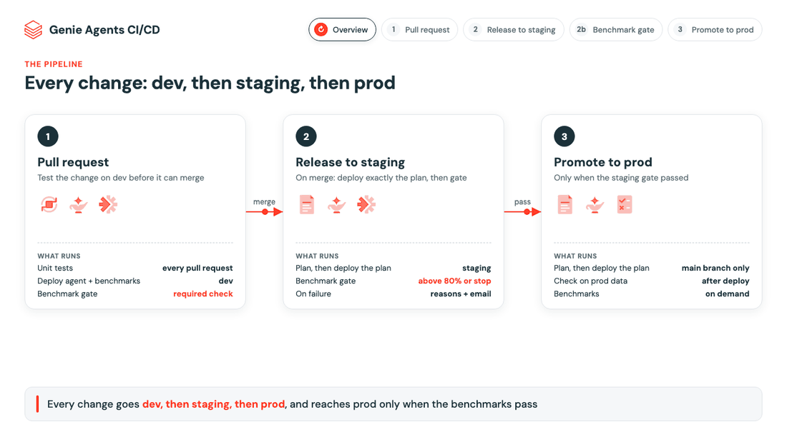

# Genie Agents CI/CD

Deploy a Genie Agent from Git through **dev, staging and prod**, with its **benchmarks deployed alongside it** and a
**benchmark gate** in the pipeline. The agent reaches prod only after a merge to `main`, and only if benchmark accuracy is
**above 80%**. If it is not, the pipeline prints each failing question with its reason, emails the team, and stops.

Copy this repository, point it at your workspace and your agent, and the pipeline works as is. It uses GitHub Actions,
[Declarative Automation Bundles](https://docs.databricks.com/aws/en/dev-tools/bundles/) and the Databricks CLI, and runs
on Databricks on AWS, Azure and Google Cloud.



The same diagram, interactive: open [`docs/cicd-pipeline.html`](docs/cicd-pipeline.html) in a browser (click a tab to open a part).

## What is in here

| Path | What it does |
| --- | --- |
| `databricks.yml` | Bundle with the `dev`, `staging` and `prod` targets. Each target points at its own catalog (`dev`, `staging`, `prod`). The prod agent is protected with `prevent_destroy`. |
| `resources/sales_agent.genie.yml` | The Genie Agent as code, written by hand: tables, entity matching, sample questions, instructions, example SQL and **20 benchmark questions** (10 questions, 2 phrasings each). |
| `resources/benchmark_gate.job.yml` | Serverless job that runs the benchmarks and fails when accuracy is not above the threshold. Email on failure goes to `alert_email`. CI runs it after each deployment; otherwise it runs on demand, or on a schedule if you add one (see below). |
| `src/benchmark_gate.py` | Starts a benchmark evaluation run, waits for it, prints accuracy and the reason for each failing question, and fails the run when accuracy is not above `min_accuracy`. |
| `scripts/run_gate.sh` | Runs the gate job for a target, prints its report in the log and the GitHub job summary, and exits non-zero on failure. |
| `scripts/plan.sh` | Writes the deployment plan for a target to `plan-<target>.json` and lists the planned changes. |
| `scripts/pull_agent.py` | Pulls changes made to your dev agent in the UI back into `sales_agent.genie.yml`. |
| `scripts/seed_demo_data.py` | Example only: creates the `customers` and `orders` tables from `samples.tpch`. |
| `docs/` | The animated pipeline diagram (`cicd-pipeline.html`, built from `cicd-pipeline_template.html`) and its GIF. |
| `tests/` | Unit tests for the gate decision and the pull normalization (`pytest`). |
| `.github/workflows/genie-pr.yml` | Pull request: unit tests, deploy to dev, run the benchmarks. |
| `.github/workflows/genie-release.yml` | Merge to `main`: plan and deploy to staging, run the gate, then plan and deploy to prod and check it on prod data. |
| `.github/workflows/genie-benchmarks.yml` | On demand: run the benchmarks in dev, staging or prod without deploying. |
| `Makefile`, `local.mk.example` | Optional shortcuts for local development (`make help`). CI calls the same commands directly. |
| `requirements.txt`, `requirements-dev.txt` | Python packages for the scripts (`databricks-sdk`, `PyYAML`) and for the tests (`pytest`). |

## One definition, three environments

Table names in the agent are written as `${var.catalog}.${var.schema}.orders`. Each target sets its own catalog, so the
same file deploys as `dev.genie_sales.orders` in dev, `staging.genie_sales.orders` in staging and `prod.genie_sales.orders`
in prod. You keep one agent definition in Git and test it against dev and staging data before it ever points at prod data.

The agent is defined inline in YAML (`serialized_space`), not in a `.geniespace.json` file, because bundle variables are
resolved in YAML but not inside an included JSON file.

## Write the agent, or build it in the UI and pull it

The smallest agent you can deploy is just its tables:

```yaml
resources:
  genie_spaces:
    sales_agent:
      title: Sales Analytics
      warehouse_id: ${var.warehouse_id}
      serialized_space:
        version: 2
        data_sources:
          tables:
            - identifier: ${var.catalog}.${var.schema}.customers
            - identifier: ${var.catalog}.${var.schema}.orders
```

Everything else is added as the agent matures. Sample questions, instructions, example SQL, joins, SQL snippets and
benchmarks each need an `id`: 32 lowercase hex characters, unique, with every list sorted by `id`. Any value works, so
number them by hand with one letter per kind of item, as `sales_agent.genie.yml` does (`a...01` for sample questions,
`b...01` for benchmarks, `c...01` for instructions, `d...01` for example SQL). Tables and column settings need no `id`.
Leave the joins out when the tables have primary and foreign keys: Genie uses them.

Two ways teams work in practice:

- **Write it in Git**, as above. Good for small agents and reviewable pull requests.
- **Build in the dev UI, then pull** with `scripts/pull_agent.py` or `databricks bundle generate genie-space`. The UI
  assigns random IDs, so a pulled file has long random IDs instead of the numbered ones above. Both deploy the same way.

## How the gate decides

The benchmarks are part of the agent definition, so every deployment ships the current benchmark set. The gate runs after
the dev deployment of a pull request and after the staging deployment of a release; after the prod deployment the same
check runs on prod data. Each time it:

1. starts a benchmark evaluation run on the deployed agent (Genie benchmark API, Beta);
2. waits until the run finishes;
3. computes accuracy as correct answers divided by benchmark questions; answers marked *needs review* count as not correct;
4. passes only when the run finished and accuracy is **above** `min_accuracy` (default `80`, set in `databricks.yml`).

On failure the report looks like this in the CI log, in the GitHub job summary and in the failure email. This is a real
run in which four benchmark answers were deliberately changed: 16 of 20 correct is 80%, which is not above 80%, so the
gate fails.

```
GENIE BENCHMARK GATE  FAILED
Agent: [dev] Sales Analytics   Target: dev
Accuracy: 80.0% (16/20 correct)   Required: above 80%
 1. [BAD] How many orders were placed in 2024?
    Reason: a value differs from the expected result; a filter is missing or wrong
    Genie answered: SELECT COUNT(*) AS `order_count` FROM `dev`.`genie_sales`.`orders` WHERE YEAR(`order_date`) = 2024
 2. [BAD] What was total revenue in 2025?
    Reason: a value differs from the expected result; a filter is missing or wrong
 ...
Benchmark gate failed on dev: the team was emailed and the pipeline stops here.
```

The release workflow's `prod` job `needs: staging`, so a failed staging gate means prod is never deployed. The staging
gate tests the agent on staging data; the check after the prod deployment confirms it on prod data and emails the team
if it fails there.

### Run the benchmarks on demand or on a schedule

Outside deployments the gate runs **on demand**: Actions > **Genie Agent benchmarks** > Run workflow, then pick dev,
staging or prod (or `scripts/run_gate.sh prod`, or Run now on the job in the workspace). This repository chose on demand,
but the run can just as well be automatic. To run it, say, every Monday in prod and catch accuracy drift as the data
changes, add a schedule to the prod target in `databricks.yml`:

```yaml
targets:
  prod:
    resources:
      jobs:
        benchmark_gate:
          schedule:
            quartz_cron_expression: "0 0 6 ? * MON" # Mondays 06:00
            timezone_id: Europe/Berlin
```

A failing scheduled run sends the same email. Each run is billed as service principal usage.

Each staging and prod deployment applies exactly the plan it shows (`databricks bundle plan`, then
`databricks bundle deploy --plan`). If the state changed in between, the deployment fails instead of applying something
else. The plans are kept as workflow artifacts, with the alert address removed.

## Set up

1. **Copy the repository.** Use it as a template or copy the files into your repository. The workflows stay switched off
   until step 6.
2. **Catalogs and warehouse.** Create the catalogs `dev`, `staging` and `prod`, or change the names in `databricks.yml`,
   and a serverless SQL warehouse in each workspace. Separate workspaces per environment are best; one workspace works too.
3. **Service principals.** Create one service principal per environment and add it to its workspace. Grant it
   `USE CATALOG` on its catalog, `USE SCHEMA` and `SELECT` on the schema, and `CAN USE` on the warehouse. Pull requests
   deploy to dev as the dev service principal, so give it access to dev data only. If the example seeds its own data,
   also grant `CREATE SCHEMA` on the catalog.
4. **Sign-in without secrets.** As an account admin, create a federation policy on each service principal for GitHub
   Actions ([AWS](https://docs.databricks.com/aws/en/dev-tools/auth/provider-github),
   [Azure](https://learn.microsoft.com/en-us/azure/databricks/dev-tools/auth/provider-github),
   [Google Cloud](https://docs.databricks.com/gcp/en/dev-tools/auth/provider-github)). Use the issuer
   `https://token.actions.githubusercontent.com` and one subject per environment. For repositories created after
   July 15, 2026, GitHub includes numeric IDs in the subject: `repo:<owner>@<owner id>/<repo>@<repo id>:environment:dev`
   (find the IDs with `gh api repos/<owner>/<repo>`); older repositories use `repo:<owner>/<repo>:environment:dev`.
5. **GitHub environments.** Create the environments `dev`, `staging` and `prod` with these variables:

   | Variable | Value |
   | --- | --- |
   | `DATABRICKS_HOST` | Workspace URL, for example `https://adb-1234567890123456.7.azuredatabricks.net` |
   | `DATABRICKS_CLIENT_ID` | Application ID of the service principal |
   | `WAREHOUSE_ID` | SQL warehouse ID |
   | `CATALOG`, `SCHEMA` | Optional: override the catalog and schema set in `databricks.yml` |

   Limit **Deployment branches** of `staging` and `prod` to `main`, so only merged code can authenticate as those
   service principals. Add required reviewers on `prod` for a manual approval before promotion.
6. **Repository settings.** Add the secret `GENIE_ALERT_EMAIL` (who gets the failure email; kept out of the code) and the
   variable `GENIE_CICD_ENABLED` = `true` to switch the workflows on. Set `SEED_EXAMPLE_DATA` = `true` only to try the
   example on its sample tables.
7. **Branch protection.** On `main`, require the status check **Genie benchmarks (dev)**, so pull requests cannot merge
   while the gate fails. That job always runs and fails until step 6 is done.
8. **Access to the agent.** `agent_users_group` (default `users`, every workspace user) gets CAN RUN on the agent and
   `owners_group` (default `admins`) gets CAN MANAGE on the agent and the gate job. Set your own groups in `databricks.yml`.

## Develop an agent change

Requirements: the [Databricks CLI](https://docs.databricks.com/aws/en/dev-tools/cli/install) 1.17.0 or later, Python 3.10
or later, and [jq](https://jqlang.org/download/). The shell scripts need bash: on Windows, use WSL or Git Bash.

```bash
# once: sign in and install the Python packages
databricks auth login --profile my-dev
export DATABRICKS_CONFIG_PROFILE=my-dev BUNDLE_VAR_warehouse_id=<sql warehouse id>
python3 -m venv .venv && .venv/bin/pip install -r requirements-dev.txt

# deploy your own dev copy (resources get a "[dev <you>]" prefix)
databricks bundle deploy --target dev

# tune the agent in the Genie UI, then pull the changes back into Git
.venv/bin/python scripts/pull_agent.py --target dev
git diff resources/sales_agent.genie.yml

# unit tests and the benchmark gate, before opening a pull request
.venv/bin/python -m pytest -q
scripts/run_gate.sh dev
```

`pull_agent.py` finds your dev agent from the bundle, downloads its definition, maps the dev catalog and schema back to
`${var.catalog}.${var.schema}`, and rewrites only `serialized_space`; title, description, warehouse and permissions stay
as they are in Git. If nothing changed in the UI, the file is left untouched. Add `--out /tmp/agent.yml` to preview, or
`--space-id <id>` to pull a different agent.

### Shortcuts with make (optional)

With `make` installed (macOS and Linux), `cp local.mk.example local.mk`, set your `PROFILE` and `VARS` there (the file is
not committed), and use `make setup`, `make test`, `make deploy`, `make pull` and `make gate`; `make help` lists them all.
Add `TARGET=staging` or `TARGET=prod` to work on another target. Without a profile, make stops with a message instead of
falling back to your `DEFAULT` CLI profile.

Add a benchmark question for every new question pattern the agent should answer, with the SQL you expect.

## Use it with your own agent

- Export an existing agent: `databricks bundle generate genie-space --existing-id <id> --key my_agent`, then move the
  generated `serialized_space` into a resource YAML file and replace the catalog and schema with `${var.catalog}` and
  `${var.schema}` (or run `scripts/pull_agent.py`).
- Point `space_id` in `resources/benchmark_gate.job.yml` at your agent's resource key, and `--agent` in
  `scripts/pull_agent.py` if you renamed it.
- Leave `SEED_EXAMPLE_DATA` unset: in your project, data pipelines own the tables. The tables must exist before the first
  deployment of an agent.

## Notes

- `genie_spaces` needs the direct deployment engine
  ([docs](https://docs.databricks.com/aws/en/dev-tools/bundles/resources#genie_space)). This repository was tested end to
  end with Databricks CLI 1.17.0 locally and 1.26.0 in CI: dev, staging and prod deployments, a passing gate (20/20) and a
  failing gate (16/20).
- The benchmark evaluation API is in Beta and may change.
- Users asking the agent are free through January 31, 2027; service principals, including the gate's benchmark runs,
  are billed. See [Genie cost](https://docs.databricks.com/aws/en/genie/monitor-cost).
